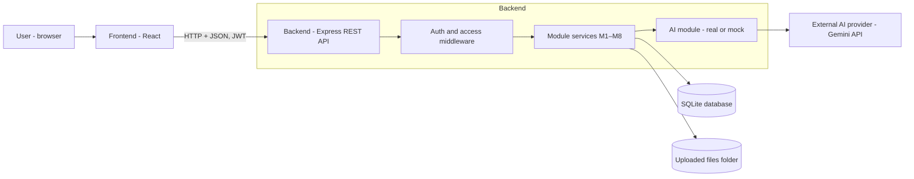
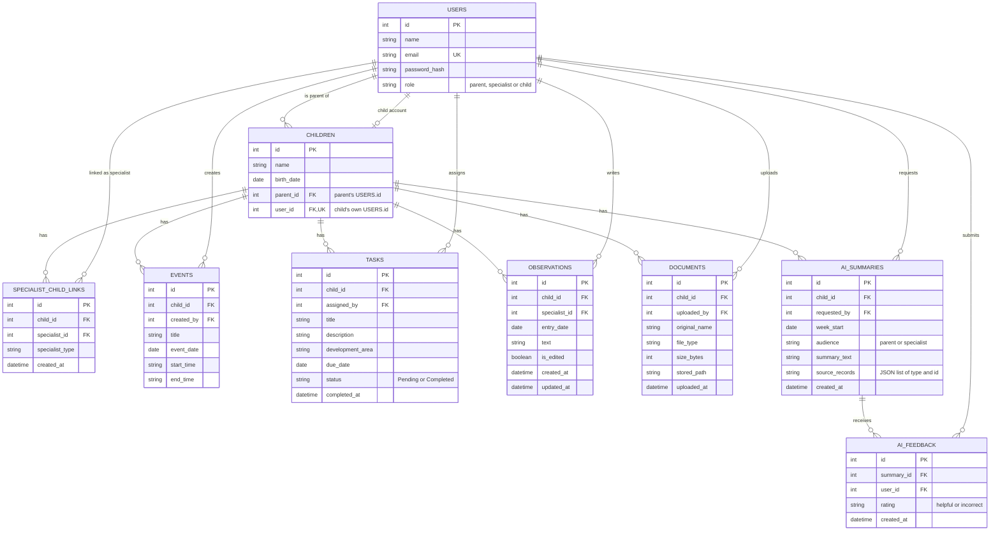

# Software Design Document (SDD)

**Team name:** Hive (Group 10, Section-1)  
**Version:** ☒ First version (Week 6) ☐ Final (Week 10)  
**Last updated:** 2026-11-07

---

## 1. Architecture Overview

The system is a client–server web application with three layers: a React frontend running in the browser, a Node.js + Express REST API, and a SQLite database. The frontend never talks to the database or the AI service directly; every request goes through the backend, which checks the user's identity and permissions before reading or changing any record. Uploaded documents are stored in a folder on the backend, and the AI service is called only by a single backend module that also provides a mock mode for tests and CI.

**Key design decisions:**

- Every protected request verifies the user's JWT and role. For child-related resources, the backend also verifies the user's relationship to the child: ownership for parents, an active link for specialists, or the child's own account where access is permitted (FR-M1-06, FR-M2-07). A failed check returns HTTP 401 (no or invalid token) or HTTP 403 (no permission).
- Weekly statistics are calculated by application code, not by the AI (FR-M7-01).
- The AI module receives only records that the requesting user may see (FR-M8-03). In mock mode (`AI_MODE=mock`) no request is sent to the external provider; the module returns a fixed summary that matches the seed data, so tests do not depend on the external service (FR-M8-09).
- The AI provider's API key is read from a backend `.env` file that is not committed to Git (NFR-03).

### Technology Stack

| Layer | Technology |
|---|---|
| Frontend | React (Vite), React Router |
| Backend | Node.js, Express, jsonwebtoken (JWT), bcrypt, multer (file upload) |
| Database | SQLite |
| AI | Gemini API, accessed only from the backend |
| Testing | Jest + Supertest (backend unit and API tests), Vitest (frontend unit tests), Playwright (end-to-end tests) |
| CI | GitHub Actions |

---

## 2. Module Design

| Module | Main components | Implements requirements |
|---|---|---|
| M1 | Frontend: `LoginPage`, `AuthContext`, `ProtectedRoute`. Backend: `authRoutes`, `authService`, `authMiddleware` (`requireAuth`, `requireRole`), `users` table. | FR-M1-01 … FR-M1-07 |
| M2 | | |
| M3 | | |
| M4 | | |
| M5 | Frontend: `ObservationList`, `ObservationForm`. Backend: `observationRoutes`, `observationService`, `observations` table. | FR-M5-01 … FR-M5-06 |
| M6 | | |
| M7 | | |
| M8 | Frontend: `AiSummaryPanel`, `FeedbackButtons`. Backend: `aiSummaryRoutes`, `aiService` with `geminiClient` and `mockClient` (selected by the `AI_MODE` setting), parent and specialist prompts, `ai_summaries` and `ai_feedback` tables. | FR-M8-01 … FR-M8-09 |

---

## 3. Data Model

The database is SQLite with foreign key checks enabled (`PRAGMA foreign_keys = ON`) when the connection is opened. Unique constraints are defined in the SQL schema as listed in the notes below.

| Table | Module | Notes |
|---|---|---|
| USERS | M1 | One table for all roles; the role comes from the account (FR-M1-03). Email is unique. |
| CHILDREN | M1, M2 | parent_id points to the parent's user record and user_id to the child's own account; both reference USERS. user_id is unique. |
| SPECIALIST_CHILD_LINKS | M2 | Unique on (child_id, specialist_id). Unlinking deletes the row; the specialist's earlier tasks and observations are kept, but access ends immediately (FR-M2-07). |
| EVENTS | M3 | |
| TASKS | M4, M7 | development_area is limited to the fixed list in FR-M4-02. M7 statistics are calculated from this table. |
| OBSERVATIONS | M5 | is_edited is set to true on the first edit (FR-M5-05). |
| DOCUMENTS | M6 | The file is stored in the uploads folder; the table keeps only its metadata. |
| AI_SUMMARIES | M8 | source_records stores the type and id of each source record, e.g. `[{"type": "task", "id": 15}, {"type": "observation", "id": 7}]` (FR-M8-06). |
| AI_FEEDBACK | M8 | Saves "helpful" or "incorrect" feedback (FR-M8-07). Unique on (summary_id, user_id); a new feedback from the same user replaces the earlier one. |

---

## 4. API / Interfaces

All endpoints except login require a valid JWT. For every endpoint that contains `:childId`, the access middleware checks that the user is the child's parent, a specialist currently linked to the child, or the child themself (only where the Access column allows it). For endpoints that identify a record by its own ID (task, observation, document or AI summary), the backend first finds the child the record belongs to and then applies the same check, so knowing a record's ID never gives access to it. Links to source records in a saved AI summary open the child's task or observation list and highlight the referenced record; the list is loaded through the normal endpoints, so the same access checks apply each time. Error responses: 400 invalid data, 401 missing or invalid token, 403 no permission, 404 record not found.

### M1 – Login and roles

| Method | Endpoint | Description | Access |
|---|---|---|---|
| POST | /api/auth/login | Log in and receive a JWT | Public |
| GET | /api/auth/me | Return the logged-in user's name and role | All roles |

### M2 – Linking specialists

| Method | Endpoint | Description | Access |
|---|---|---|---|

### M3 – Weekly schedule

| Method | Endpoint | Description | Access |
|---|---|---|---|

### M4 – Tasks

| Method | Endpoint | Description | Access |
|---|---|---|---|

### M5 – Specialist entries

| Method | Endpoint | Description | Access |
|---|---|---|---|
| GET | /api/children/:childId/observations | List observations | Parent, linked specialist |
| POST | /api/children/:childId/observations | Add an observation | Linked specialist |
| PATCH | /api/observations/:observationId | Edit an observation | Author specialist, still linked |

### M6 – Documents

| Method | Endpoint | Description | Access |
|---|---|---|---|

### M7 – Weekly statistics

| Method | Endpoint | Description | Access |
|---|---|---|---|

### M8 – Role-based AI summary

| Method | Endpoint | Description | Access |
|---|---|---|---|
| POST | /api/children/:childId/ai-summaries | Create an AI summary for a week | Parent, linked specialist |
| POST | /api/ai-summaries/:summaryId/feedback | Save helpful or incorrect feedback | Parent, linked specialist of the summary's child |

---

## 5. Critical Flows

### Flow 1: A specialist assigns a task and the child completes it

### Flow 2: An unlinked specialist loses access

### Flow 3: The parent views weekly statistics and the AI summary

---

## 6. User Interface

The main screens follow the example screens in Appendix A of the assignment, limited to the required scope. Wireframes are stored in `docs/img/`.

| Screen | Image | Module |
|---|---|---|
| Login |  | M1 |
| Parent – weekly dashboard (schedule, tasks, entries, statistics, AI summary) |  | M3, M4, M5, M7, M8 |
| Parent – linked specialists |  | M2 |
| Parent – documents |  | M6 |
| Specialist – child profile and observations |  | M2, M5, M8 |
| Specialist – assign and track tasks |  | M4 |
| Child – my tasks and schedule |  | M1, M3, M4 |

---

## 7. Change Log

| Date | Change | By |
|---|---|---|
