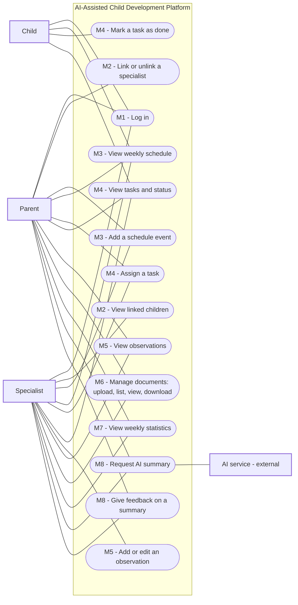

# Software Requirements Specification (SRS)

**Team name:** Hive (Group 10, Section-1)  
**Version:** ☒ First version (Week 6) ☐ Final (Week 10)  
**Last updated:** 2026-11-07

---

## 1. Introduction

**Purpose of the system:**  
The system is a web-based decision support platform that brings a child's parents and specialists together around one shared weekly schedule, task list and record of observations. An AI component summarizes the week's records for each reader according to their role. The AI provides summaries to support human decision-making but does not make decisions on behalf of users. Each summary is labelled as AI-generated and linked to its source records.

**Users of the system:**

| User type | Description |
|---|---|
| Parent | Owns the child's data, sees all of the child's records and links or unlinks specialists. |
| Specialist | Teacher, psychologist, doctor, special education teacher or coach. Works only with the children they are linked to. |
| Child | Sees only their own tasks and weekly schedule, and marks tasks as done. |

---

## 2. Functional Requirements

### M1 – Login and roles

| ID | Requirement | Priority |
|---|---|---|
| FR-M1-01 | The system shall allow a registered user to log in with email and password. | Must |
| FR-M1-02 | The system shall reject a login with a wrong email or password and show an error message. | Must |
| FR-M1-03 | The system shall take the user's role (parent, specialist or child) from the account; the user shall not choose a role at login. | Must |
| FR-M1-04 | The system shall issue a signed token with an expiry time after a successful login and require it for every protected API request. | Must |
| FR-M1-05 | The system shall redirect each user to their role's home screen after login and show only that role's screens. | Must |
| FR-M1-06 | The system shall reject an API request for another role's function with an authorization error, even if the request is sent without the user interface. | Must |
| FR-M1-07 | The system shall allow the user to log out. | Should |

### M2 – Linking specialists

| ID | Requirement | Priority |
|---|---|---|
| FR-M2-01 | The system shall allow a parent to link a registered specialist to their child by email and specialist type (teacher, psychologist, doctor, special education teacher or coach). | Must |
| FR-M2-02 | The system shall show an error message when the entered email does not belong to a registered specialist. | Must |
| FR-M2-03 | The system shall show the parent a list of the specialists linked to their child, with name, email and type. | Must |
| FR-M2-04 | The system shall allow a parent to unlink a specialist after a confirmation step. | Must |
| FR-M2-05 | The system shall show a specialist the list of children they are currently linked to. | Must |
| FR-M2-06 | The system shall allow only the child's parent to link or unlink specialists. | Must |
| FR-M2-07 | The system shall reject every API request about a child from a specialist who is not currently linked to that child, checking the current link on each request even if the user's token is still valid. | Must |
### M3 – Weekly schedule

| ID | Requirement | Priority |
|---|---|---|
| FR-M3-01 | The system shall allow a parent or a linked specialist to add an event to the child's schedule with a title, date, start time and end time. | Must |
| FR-M3-02 | The system shall reject an event with a missing title or an end time that is earlier than or equal to its start time and show an error message. | Must |
| FR-M3-03 | The system shall list the child's events for a selected week (Monday to Sunday) in a weekly view, ordered by day and time. | Must |
| FR-M3-04 | The system shall allow the user to move to the previous or next week in the weekly view. | Should |
| FR-M3-05 | The system shall show the child their own weekly schedule without the option to add or change events. | Must |

### M4 – Tasks

| ID | Requirement | Priority |
|---|---|---|
| FR-M4-01 | The system shall allow a parent or a linked specialist to assign a task to the child with a title, description, development area and due date. | Must |
| FR-M4-02 | The system shall offer a fixed list of development areas: Language, Motor, Cognitive, Social-Emotional and Self-Care. | Must |
| FR-M4-03 | The system shall reject a task with a missing title, development area or due date and show an error message. | Must |
| FR-M4-04 | The system shall give every new task the status "Pending". | Must |
| FR-M4-05 | The system shall show the child a list of their own tasks with title, description, development area, due date and status. | Must |
| FR-M4-06 | The system shall allow the child to mark their own task as done, which changes its status to "Completed". | Must |
| FR-M4-07 | The system shall show the user who assigned tasks a list of those tasks with their current status. | Must |

### M5 – Specialist entries

| ID | Requirement | Priority |
|---|---|---|
| FR-M5-01 | The system shall allow a linked specialist to add a dated observation about the child. | Must |
| FR-M5-02 | The system shall reject an observation with a missing date or empty text and show an error message. | Must |
| FR-M5-03 | The system shall show the parent and linked specialists the child's observations, newest first, with date, author name and specialist type. | Must |
| FR-M5-04 | The system shall allow only the specialist who wrote an observation to edit it. | Must |
| FR-M5-05 | The system shall mark an edited observation with an "edited" label. | Must |
| FR-M5-06 | The system shall not show observations to the child, and shall reject the child's API requests for observations. | Must |

### M6 – Documents

| ID | Requirement | Priority |
|---|---|---|
| FR-M6-01 | The system shall allow a parent or a linked specialist to upload a PDF or image file (JPG, PNG) for the child. | Must |
| FR-M6-02 | The system shall reject a file of another type or larger than 10 MB and show an error message. | Must |
| FR-M6-03 | The system shall show the parent and linked specialists a list of the child's documents with name, type, uploader and upload date. | Must |
| FR-M6-04 | The system shall allow the parent and linked specialists to view and download a document. | Must |
| FR-M6-05 | The system shall not show documents to the child, and shall reject the child's API requests for documents. | Must |
### M7 – Weekly statistics

| ID | Requirement | Priority |
|---|---|---|
| FR-M7-01 | The system shall calculate the task completion rate for a selected week as the number of completed tasks due in that week divided by the total number of tasks due in that week, shown as a whole-number percentage rounded to the nearest integer. | Must |
| FR-M7-02 | The system shall show the completion rate for each development area in the selected week. | Must |
| FR-M7-03 | The system shall show "No tasks" instead of a rate when the selected week or development area has no tasks. | Must |
| FR-M7-04 | The system shall show the weekly statistics to the parent and linked specialists. | Must |
### M8 – Role-based AI summary

| ID | Requirement | Priority |
|---|---|---|
| FR-M8-01 | The system shall allow a parent or a linked specialist to request an AI summary of the child's records for a selected week (tasks, task status and observations). | Must |
| FR-M8-02 | The system shall use a separate prompt for parents (plain language) and for specialists (professional language). | Must |
| FR-M8-03 | The system shall send the AI service only the records that the requesting user is allowed to see. | Must |
| FR-M8-04 | The system shall instruct the AI to use only the given records, to state when information is missing, and not to diagnose or suggest treatment. | Must |
| FR-M8-05 | The system shall label every summary as "AI-generated". | Must |
| FR-M8-06 | The system shall show links to the source records that the summary is based on. | Must |
| FR-M8-07 | The system shall allow the user to submit a "helpful" or "incorrect" feedback for an AI summary and save it. | Must |
| FR-M8-08 | The system shall show an error message when the AI service is unavailable, while all other functions keep working. | Must |
| FR-M8-09 | The system shall provide a mock mode that returns a fixed sample summary, used in automated tests and CI. | Must |

---

## 3. Non-Functional Requirements

| ID | Category | Requirement |
|---|---|---|
| NFR-01 | Security | Passwords are stored only as bcrypt hashes; no plain-text password is stored or logged. |
| NFR-02 | Security | Login tokens expire after 1 hour and contain no password or child record data. |
| NFR-03 | Security | The AI provider's API key is stored only on the backend in an environment file that is excluded from Git; it never appears in frontend code or in the repository. |
| NFR-04 | Privacy | The system uses only synthetic data created by the seed script; no real personal data is used at any stage. |
| NFR-05 | Installability | The application shall be installable and runnable locally by following the README instructions, without requiring undocumented configuration steps. |

---

## 4. Critical Flows and Acceptance Criteria

| Flow | Related requirements | Acceptance criteria |
|---|---|---|
| Flow 1: A specialist assigns a task and the child completes it | FR-M1-01, FR-M2-07, FR-M4-01, FR-M4-04, FR-M4-06, FR-M4-07 | *Given* a specialist linked to a child *When* the specialist assigns the task "Read for 20 minutes" and the child logs in and marks it as done *Then* the child first sees the task as "Pending", and the specialist then sees its status as "Completed". |
| Flow 2: An unlinked specialist loses access | FR-M2-04, FR-M2-07 | *Given* a linked specialist who is logged in with a valid token *When* the parent unlinks the specialist and the specialist then requests the child's tasks *Then* the API returns HTTP 403 Forbidden and no child data is returned. |
| Flow 3: The parent views weekly statistics and the AI summary | FR-M7-01, FR-M7-02, FR-M8-01, FR-M8-05, FR-M8-06, FR-M8-09 | *Given* a week with 5 tasks due (2 Language tasks, both completed; 3 Motor tasks, 1 completed) and the AI service in mock mode *When* the parent opens the weekly dashboard and requests the AI summary *Then* the total completion rate is shown as 60%, Language as 100% and Motor as 33%, and the summary is labelled "AI-generated" with links to its source records. |
---

## 5. Use Case Diagram

---

## 6. Change Log

| Date | Change | By |
|---|---|---|
| 2026-11-07 | First version | Hive team |
